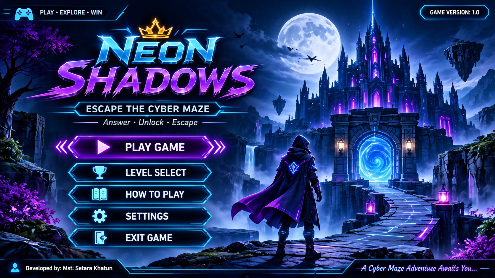
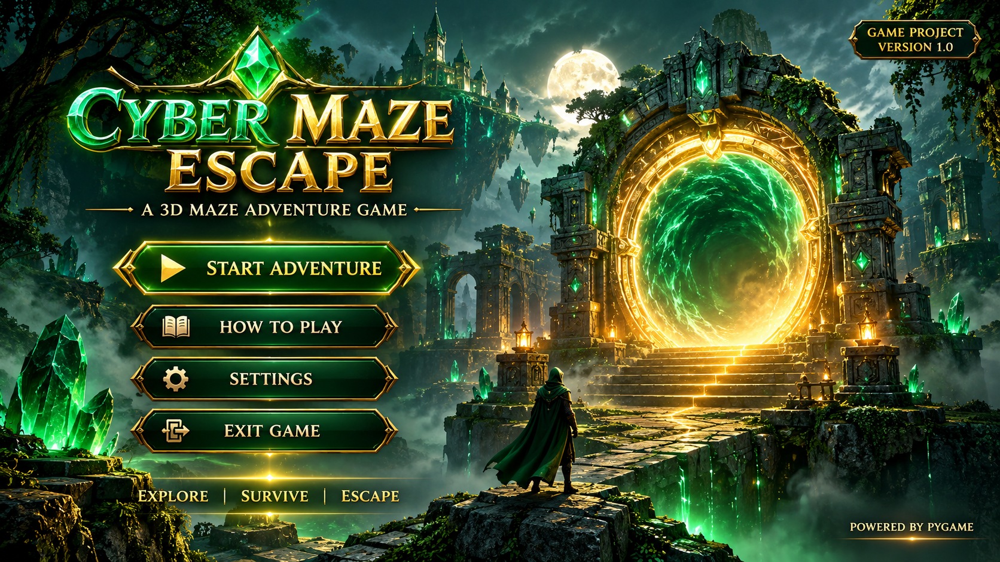
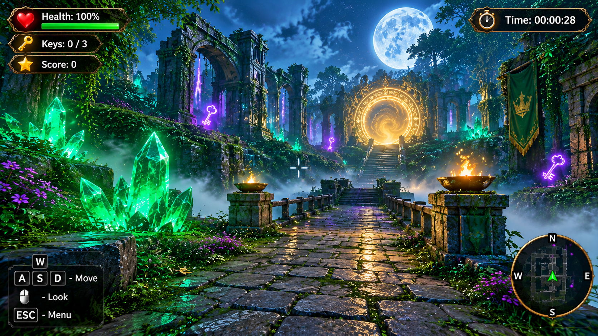
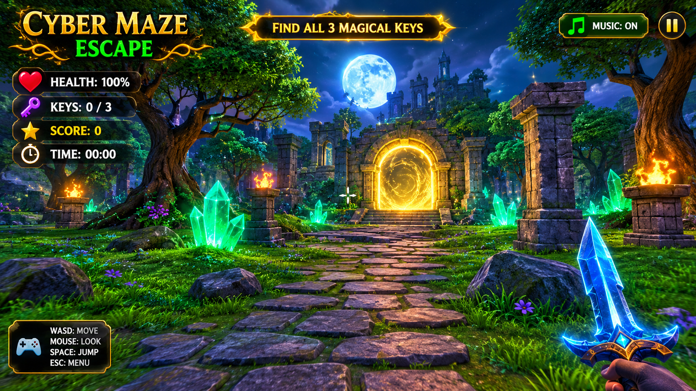

<div align="center">

# NEON SHADOWS
### ESCAPE THE CYBER MAZE

**A 2D Cyberpunk Maze Adventure Game**


**Explore the maze · Solve cyber challenges · Escape to the next level**

</div>

---

## Table of Contents
- [Project Overview](#project-overview)
- [Visual Preview](#visual-preview)
- [Gameplay](#gameplay)
- [Features](#features)
- [Graphics and Algorithms](#graphics-and-algorithms)
- [Controls](#controls)
- [Technology Stack](#technology-stack)
- [Project Structure](#project-structure)
- [Installation](#installation)
- [Development Roadmap](#development-roadmap)
- [Documentation](#documentation)
- [Project Information](#project-information)

## Project Overview

**NEON SHADOWS: Escape the Cyber Maze** is an individual Computer Graphics Lab project developed with Python and Pygame CE. It is a cyberpunk-inspired 2D maze adventure in which the player navigates a generated maze, interacts with a cyber terminal, answers computer-science quiz questions, and unlocks the exit to advance.

The project combines real-time input handling, grid-based maze representation, collision detection, graphical user-interface elements, timed challenges, audio playback, and game-state management.

## Visual Preview

### Main Menu



### Additional Visual Concepts

The following images are design and gameplay reference assets used during development; they are not presented as captured gameplay screenshots.

| Cinematic Menu Direction | Gameplay Concept |
|---|---|
|  |  |

| Gameplay Reference | Gameplay Scene Reference |
|---|---|
|  |  |

## Gameplay

1. Start the game from the cyberpunk main menu.
2. Navigate the maze using the movement keys.
3. Find the cyber terminal and press **E** to interact.
4. Answer the computer-science question before the countdown ends.
5. A correct answer unlocks the exit.
6. Reach the unlocked exit and press **Enter** to continue.

The game includes multiple levels, a score and lives system, and victory or game-over result screens.

## Features

| Feature | Description |
|---|---|
| Cyberpunk main menu | Custom visual menu screen |
| Background music | Looping background soundtrack with a music toggle |
| Procedural maze | Grid-based maze generation |
| Player movement | Keyboard movement with wall-collision checks |
| Cyber terminal | Interactive quiz challenge |
| Quiz system | Computer-science multiple-choice questions |
| Countdown | Timed question challenge |
| Lives and score | Tracks player performance |
| Enemy logic | Patrolling enemy movement and player-hit handling |
| Level progression | Unlock an exit and advance through levels |
| Result screens | Victory and game-over states |
| Settings and help pages | In-game navigation and instructions |

## Graphics and Algorithms

- **Grid-based representation:** The maze is represented as rows and columns of cells.
- **Procedural generation:** A randomized depth-first search (DFS) maze-carving approach is used to create maze paths.
- **Collision detection:** Player movement is checked against maze walls.
- **Real-time game loop:** Pygame processes events, updates game state, and renders frames.
- **Enemy movement:** An enemy follows a predefined path and changes direction at path boundaries.
- **HUD and interface:** Text, panels, counters, and status messages communicate game information.

## Controls

| Key | Action |
|---|---|
| `W` / `↑` | Move up |
| `S` / `↓` | Move down |
| `A` / `←` | Move left |
| `D` / `→` | Move right |
| `E` | Interact with cyber terminal |
| `Enter` | Confirm / enter unlocked exit |
| `Esc` | Back / return from a page |

## Technology Stack

| Technology | Purpose |
|---|---|
| Python 3 | Core programming language |
| Pygame CE | Game window, rendering, input, audio and timing |
| Visual Studio Code | Development environment |
| Git | Version control |
| GitHub | Source-code hosting and project documentation |

## Project Structure

```text
Cyber-Maze-Escape/
├── Assets/
│   ├── Backgrounds/
│   │   ├── cinematic_menu.png
│   │   ├── fantasy_music.wav
│   │   ├── gameplay_concept.png
│   │   ├── gameplay_reference.png
│   │   ├── gameplay_scene.png
│   │   └── main_menu_design.png
│   └── University/
│       └── nubtk_logo.png
├── src/
│   └── main.py
├── Weekly-Progress/
│   └── Week-01.md
├── Cyber-Maze-Escape-Proposal.md
├── create_proposal_pdf.py
├── requirements.txt
├── .gitignore
└── README.md
```

## Installation

### Prerequisites
- Python 3.10 or later
- Git

### 1. Clone the repository

```bash
git clone https://github.com/Mst-setara-khatun/Cyber-Maze-Escape.git
cd Cyber-Maze-Escape
```

### 2. Create and activate a virtual environment

**Windows PowerShell**
```powershell
python -m venv .venv
.\.venv\Scripts\Activate.ps1
```

### 3. Install dependencies

```bash
python -m pip install -r requirements.txt
```

### 4. Run the game

```bash
python src/main.py
```

## Development Roadmap

- [x] Week 01 — Project setup, proposal, repository and playable prototype
- [ ] Week 02 — Gameplay refinement and environment improvements
- [ ] Week 03 — Maze and player improvements
- [ ] Week 04 — Gameplay mechanics and interactions
- [ ] Week 05 — Enemy, scoring and visual-effect refinement
- [ ] Week 06 — Testing, optimization and final presentation

## Documentation

- [Project Proposal](Cyber-Maze-Escape-Proposal.md)
- [Week 01 Progress Report](Weekly-Progress/Week-01.md)

## Project Information

| Field | Details |
|---|---|
| Project | NEON SHADOWS: Escape the Cyber Maze |
| Course | Computer Graphics Lab |
| Project Type | Individual Game Development Project |
| Developer | Mst. Setara Khatun |
| Student ID | 11230321387 |
| University | Northern University of Business and Technology Khulna |
| Language | Python |
| Library | Pygame CE |

---

<div align="center">

**NEON SHADOWS — Every Maze Has an Exit.**

Made for learning, creativity, and the love of game development.

</div>
