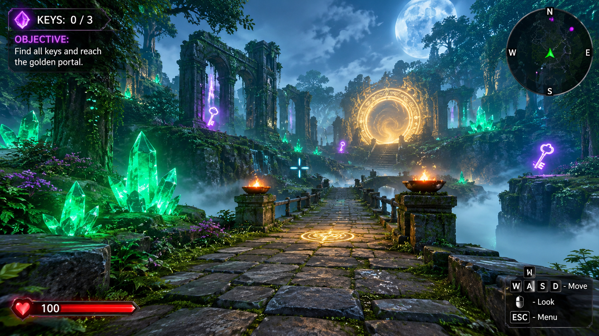

<div align="center">

#  CYBER MAZE ESCAPE

### A 3D Maze Adventure Game

**Explore the Maze • Collect the Keys • Escape the Cyber World**


</div>

---

 Table of Contents:

- About the Project
- Game Overview
- Key Features
- Gameplay Objectives
- Game Controls
- Technologies Used
- Project Structure
- Installation and Setup
- Development Progress
- Visual Assets
- Project Proposal
- Future Improvements
- Developer

---
 About the Project:

**Cyber Maze Escape** is a futuristic 3D-style maze adventure game developed using Python and Pygame-CE.

The player explores a mysterious cyber world, collects hidden keys, avoids dangerous enemies, and searches for the final escape portal.

The project focuses on fundamental computer graphics concepts, including ray casting, object projection, collision detection, animation, and interactive game mechanics.

Game Overview:

The player starts inside a mysterious maze and must collect three hidden keys to reach the final escape portal.

A moving cyber enemy patrols the maze and can damage the player upon collision. The player must manage their health, collect all keys, and reach the portal to win.


Key Features:

Futuristic Main Menu
- Cyberpunk-inspired interface.
- Start, Help, Settings, About, and Exit options.
- Animated background particles.
- Background music and volume controls.

3D-Style Maze Environment
- Ray casting-based environment rendering.
- First-person perspective.
- Wall rendering and depth-based visibility.
- Dynamic object projection.

 Player Movement
- Forward and backward movement.
- Left and right strafing.
- Mouse-based camera control.
- Wall collision detection.

 Key Collection System
- Three collectible keys.
- Key collection detection.
- Score rewards.
- Collection progress display.

Enemy System
- Moving enemy with patrol behavior.
- Enemy sprite rendering.
- Player-enemy collision detection.
- Health reduction and damage cooldown.

 Health and HUD
- Player health display.
- Key collection counter.
- Score display.
- Game timer.

Victory and Game Over
- Final portal and escape condition.
- Victory screen.
- Game Over screen.
- Final score display.
- Restart option after Game Over.

Gameplay Objectives
1. Start the game from the main menu.
2. Explore the maze.
3. Collect all three keys.
4. Avoid the moving enemy.
5. Maintain player health.
6. Reach the final portal.
7. Escape the maze and achieve the highest possible score.

## 🎮 Game Controls

| Key / Input | Action |
|---|---|
| W / ↑ | Move Forward |
| S / ↓ | Move Backward |
| A | Strafe Left |
| D | Strafe Right |
| Mouse | Look Around |
| ← / → | Rotate Camera |
| ESC | Return to Main Menu |
| R | Restart After Game Over |

## 🛠️ Technologies Used

| Technology | Purpose |
|---|---|
| Python 3.14 | Core Programming Language |
| Pygame-CE 2.5.8 | Game Development Framework |
| Ray Casting | 3D-Style Environment Rendering |
| Pygame Drawing API | Graphics and Sprite Rendering |
| Math Module | Geometry and Object Projection |
| Random Module | Particle Animation |

### Development Tools
- Visual Studio Code
- Windows PowerShell
- Python Virtual Environment
- Git and GitHub

## 📂 Project Structure

```text
CyberMaze/
│
├── Assets/
│   └── Backgrounds/
│       ├── cinematic_menu.png
│       ├── fantasy_music.wav
│       ├── gameplay_concept.png
│       ├── gameplay_reference.png
│       └── gameplay_scene.png
│
├── Weekly-Progress/
│   └── Week-01.md
│
├── main.py
├── game_engine.py
├── Cyber-Maze-Escape-Proposal.md
└── README.md
```

*Development backups and experimental scripts are omitted from this overview.*

## 🚀 Installation and Setup

### Prerequisites
- Python 3.14
- Git
- Visual Studio Code (recommended)

### 1. Clone the Repository

```bash
git clone https://github.com/Mst-setara-khatun/Cyber-Maze-Escape.git
cd Cyber-Maze-Escape
```

### 2. Create a Virtual Environment

```bash
python -m venv .venv
```

### 3. Activate the Environment

For Windows PowerShell:

```powershell
.\.venv\Scripts\Activate.ps1
```

### 4. Install Pygame-CE

```bash
pip install pygame-ce
```

### 5. Run the Game

```bash
python main.py
```

## 📅 Development Progress

| Development Phase | Tasks | Status |
|---|---|---|
| Week 01 | Project setup and futuristic main menu | ✅ Completed |
| Maze Development | Ray casting and maze environment | ✅ Implemented |
| Player Mechanics | Movement and collision detection | ✅ Implemented |
| Game Mechanics | Keys, scoring, and portal | ✅ Implemented |
| Enemy System | Enemy movement and collision | ✅ Implemented |
| Game States | Health, victory, game over, restart | ✅ Implemented |
| Final Testing | Gameplay testing and bug fixing | 🔄 Pending |

*Implementation status and final gameplay verification are tracked separately.*

### Week 01: Project Setup and Futuristic Main Menu

Completed tasks:
- Created the project directory.
- Set up the Python virtual environment.
- Installed Pygame-CE.
- Created the main game window.
- Designed a futuristic cyberpunk-style main menu.
- Added Start Game and Exit Game buttons.
- Added animated background particles and cyber visual effects.

**Next planned task:** Improve enemy AI, level design, sound effects, and complete final gameplay testing.

[View Week 01 Progress Report](Weekly-Progress/Week-01.md)

## 🖼️ Visual Assets

### Main Menu


### Gameplay Concept


### Gameplay Reference



### Gameplay Scene


*These images are project visual assets and may not represent final gameplay screenshots.*

## 📄 Project Proposal

Read the complete project proposal:

**[Cyber Maze Escape – Project Proposal](Cyber-Maze-Escape-Proposal.md)**

The proposal includes:
- Introduction and motivation.
- Problem statement.
- Project objectives.
- Game concept and story.
- Gameplay description.
- Main features and game rules.
- Graphics and visual design.
- Technologies and tools.
- Six-week development timeline.
- Expected outcomes.

## 🔮 Future Improvements

- More challenging maze levels.
- Multiple enemy types.
- Improved enemy intelligence.
- Additional visual effects and animations.
- More interactive obstacles.
- High-score saving system.
- Enhanced sound effects.
- Improved gameplay balancing.

## 👩‍💻 Developer

<div align="center">

### MST. SETARA KHATUN

**Computer Science and Engineering (CSE)**

Northern University of Business and Technology Khulna

**Project:** Cyber Maze Escape
**Category:** Computer Graphics Lab Project
**Language:** Python

</div>

---

<div align="center">

### 🌟 CYBER MAZE ESCAPE

**Explore the Unknown. Collect the Keys. Escape the Maze.**

*Developed as an academic Computer Graphics project.*

</div>
